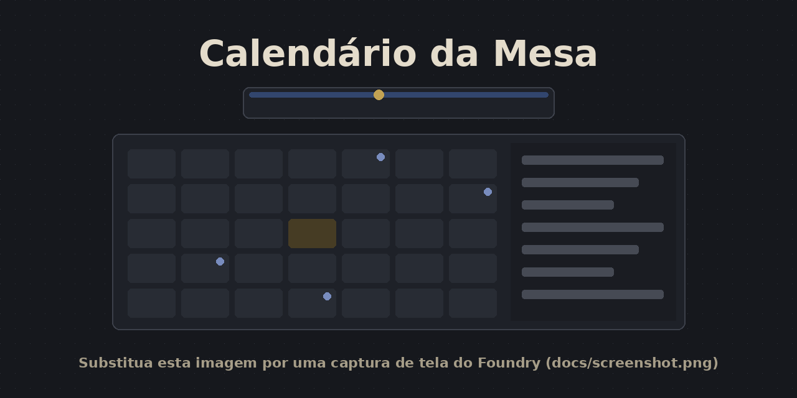
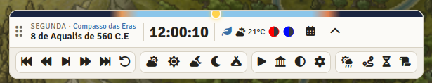
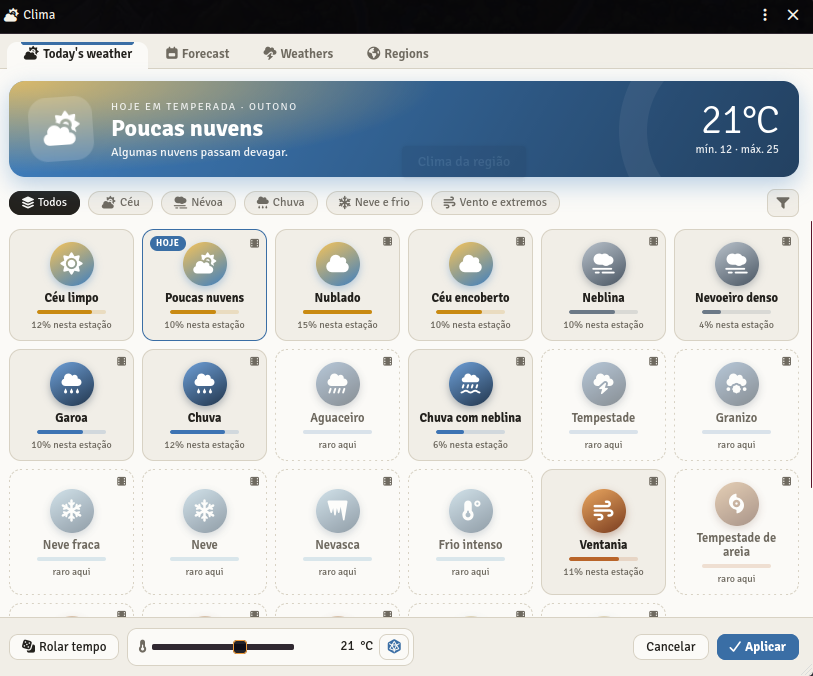
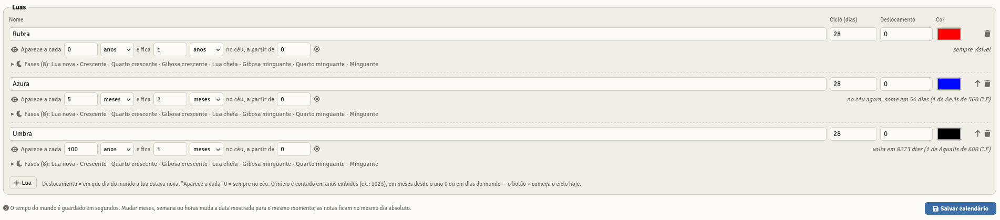
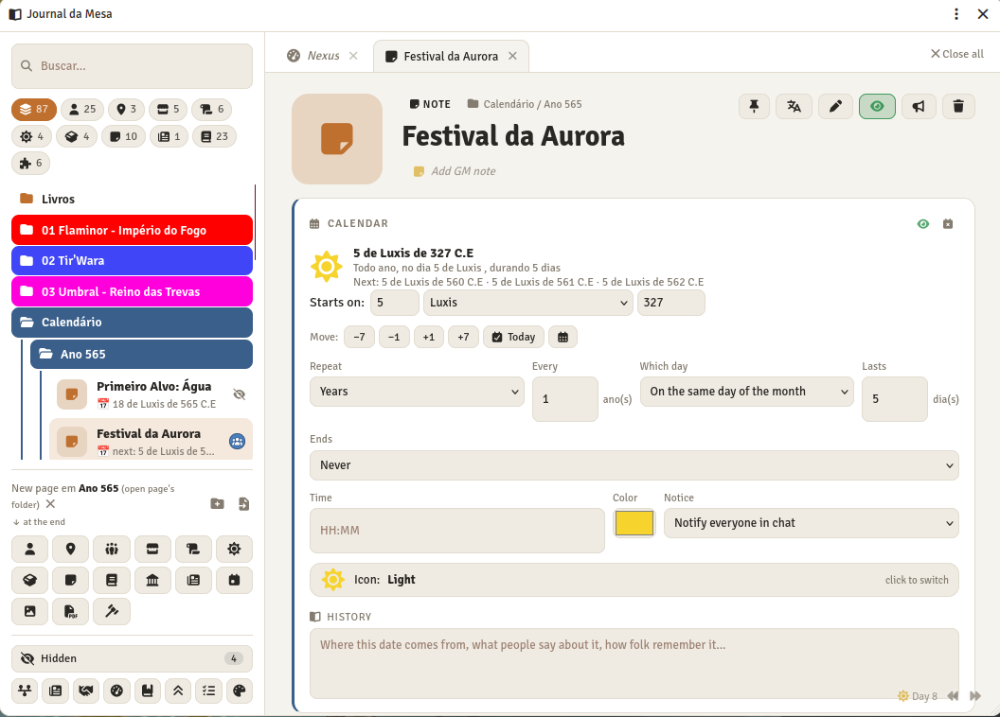
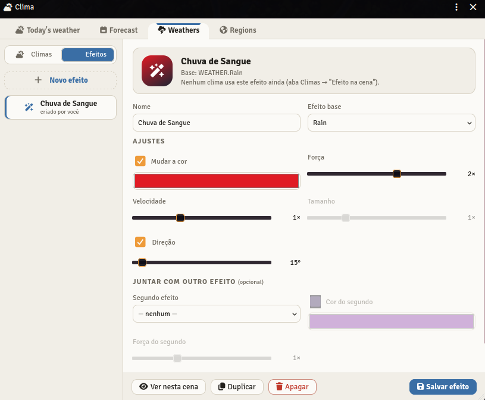
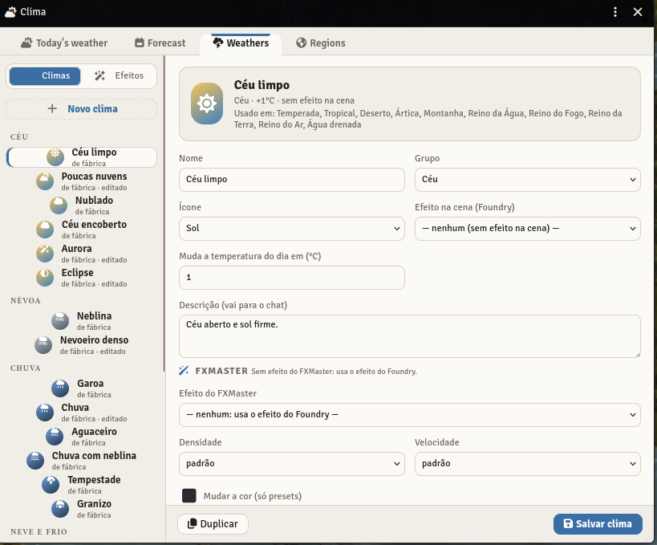
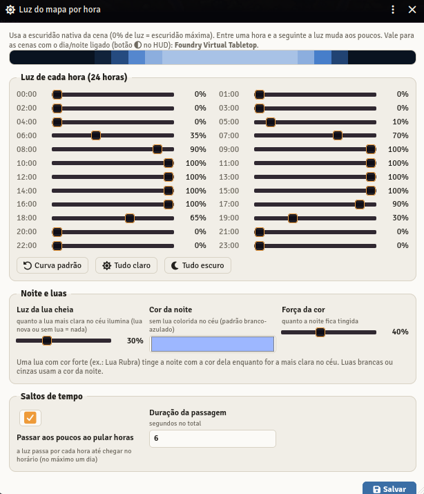
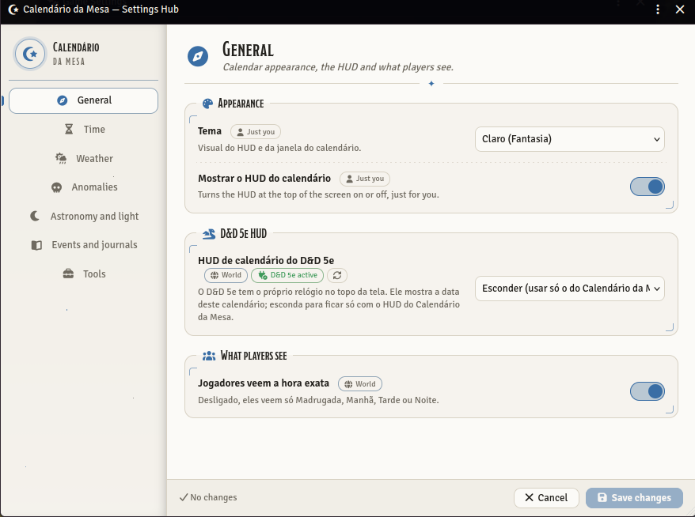
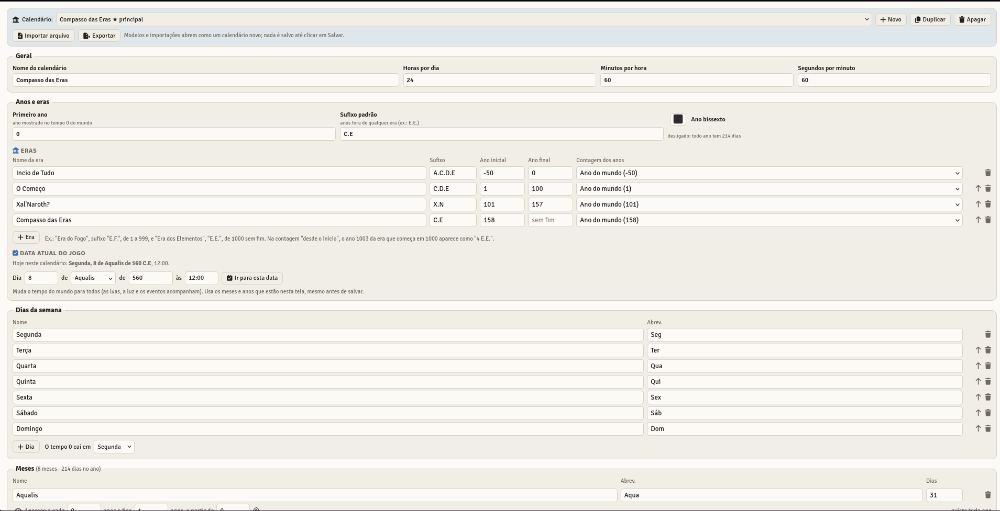

# Calendário da Mesa

## Sobre como este módulo foi feito

Sei que parte da comunidade não gosta de módulos produzidos com IA, então prefiro ser transparente: este foi desenvolvido com ajuda de IA. Não sou programador.

Tudo começou quando um amigo me disse: “cara, ficou muito mais simples, é só fazer uma macro do que você quer”. Fiz a macro para a minha mesa, fui adaptando conforme a necessidade dos jogos e, no fim, ela virou um módulo. Uso nas minhas próprias sessões e resolvi compartilhar caso seja útil para mais alguém.

Se encontrar bugs ou tiver sugestões, abra uma [issue](https://github.com/Daphenius/calendario-mesa/issues). Todo retorno é bem-vindo.

---

**Versão 4.3.0** · Foundry VTT 14 · D&D 5e 6 · Português e English · Licença MIT · ✅ Testado e aprovado no Foundry



Calendário próprio do mundo para Foundry VTT, usando o **tempo nativo do Foundry** (o mesmo relógio que avança nas rodadas de combate). Traz HUD com relógio, luz do mapa por hora, estações, eras, luas com fases, clima por região (inclusive pelas Regiões nativas do mapa), contadores e prazos, viagem dia a dia com vigias, histórico da campanha, vários calendários e notas guardadas como Diários nativos. Funciona sozinho ou junto com o **Journal da Mesa**.

> O Calendário da Mesa é um projeto independente. Alguns extras foram inspirados no estilo do Calendaria, mas o projeto não é afiliado a ele nem a seu autor. Simple Calendar, Seasons & Stars, Calendaria e Fantasy-Calendar.com aparecem neste README só porque o módulo importa calendários nesses formatos.

- [Galeria](#galeria)
- [Compatibilidade](#compatibilidade)
- [Instalação e atualização](#instalação-e-atualização)
- [Suporte e sugestões](#suporte-e-sugestões)
- [Primeiro uso](#primeiro-uso)
- [Clima por região](#clima-por-região)
- [Integração com o Journal da Mesa](#integração-com-o-journal-da-mesa)
- [Para macros e outros módulos](#para-macros-e-outros-módulos)
- [Licença e créditos](#licença-e-créditos)
- [English summary](#english-summary)

## Galeria

| HUD | Clima do dia | Luas |
|---|---|---|
| [](docs/hud.png) | [](docs/clima.png) | [](docs/luas.png) |
| **Integrado ao Journal da Mesa** | **Efeitos de clima** | **Regiões de clima** |
| [](docs/journal-da-mesa.png) | [](docs/clima-efeitos.png) | [](docs/clima-configuracoes.png) |
| **Luz por hora** | **Central de Configurações** | **Configurações** |
| [](docs/luz-por-hora.png) | [](docs/central-configuracoes.png) | [](docs/configuracoes.png) |

Clique numa imagem para ver em tamanho maior.

## Compatibilidade

| | Mínimo | Testado |
|---|---|---|
| Foundry VTT | 14 | 14.369 |
| D&D 5e | — | 6.0.6 |

**Testado e aprovado.** A versão 4.3.0 foi testada e aprovada pelo autor dentro do Foundry VTT, nas versões indicadas acima (Foundry 14.369 e D&D 5e 6.0.6), antes da publicação. Como em qualquer módulo, recomendamos fazer backup do mundo antes de atualizar.

**Foundry 13 não é mais suportado** a partir da 4.3.0. Quem ainda usa o Foundry 13 pode continuar na 4.2.1, disponível na [página de releases](https://github.com/Daphenius/calendario-mesa/releases).

Com o D&D 5e, o calendário usa como base o calendário do próprio sistema (veja [D&D 5e 6 e Foundry 14](#dd-5e-6-e-foundry-14)). Em outros sistemas ele usa o calendário nativo do Foundry, mas só foi testado no D&D 5e.

## Instalação e atualização

### Instalar pelo Foundry (recomendado)

1. No Foundry, vá em **Módulos Complementares → Instalar Módulo**.
2. No campo **URL do Manifesto**, cole:

   ```
   https://github.com/Daphenius/calendario-mesa/releases/latest/download/module.json
   ```

3. Clique em **Instalar**, entre no mundo e ative **Calendário da Mesa** em *Gerenciar Módulos*.

Instalado assim, o Foundry avisa quando houver versão nova e atualiza pelo botão de atualizar.

### Instalar manualmente

1. Baixe `calendario-mesa.zip` na [página de releases](https://github.com/Daphenius/calendario-mesa/releases).
2. Extraia em `Data/modules/calendario-mesa` (a pasta precisa ter esse nome).
3. Reinicie o Foundry e ative **Calendário da Mesa** em *Gerenciar Módulos* no seu mundo.

### Atualizar manualmente

Apague a pasta `Data/modules/calendario-mesa` e extraia a versão nova no lugar. O calendário, as notas, o clima e o histórico ficam salvos no mundo, não na pasta do módulo, e são mantidos entre versões. Mesmo assim, faça backup do mundo antes de atualizar.

### Módulos recomendados (opcionais)

- **Journal da Mesa**: notas do calendário editadas no Journal da Mesa, dia das lojas, horário das lojas, Linha do tempo, dias sagrados das divindades e Nexus mudando o clima.
- **FXMaster**: presets e partículas para os efeitos de clima.

---

## Suporte e sugestões

Encontrou um problema ou tem uma ideia? Abra uma [Issue no GitHub](https://github.com/Daphenius/calendario-mesa/issues).

Para relatar um problema, inclua:

- versão do **Foundry VTT**, do sistema (**D&D 5e**) e do **Calendário da Mesa**;
- outros módulos ativos que possam estar envolvidos (Journal da Mesa, FXMaster, outros módulos de calendário…);
- **passo a passo** para o problema acontecer;
- o que você esperava e o que aconteceu;
- a **mensagem de erro** do console (aperte **F12**, aba *Console*), se houver;
- se o problema for de clima, o resultado de `game.modules.get("calendario-mesa").api.diagnosticoClima()` no console;
- se possível, uma captura de tela.

Use só um módulo de calendário por vez: com Simple Calendar, Seasons & Stars ou Calendaria ativos junto, os dois tentam controlar a data do mundo. Para trazer um calendário de um deles, use **Importar do mundo** (veja abaixo) e depois desative o outro módulo.

---

## Primeiro uso

1. No HUD (barra no topo da tela), clique na engrenagem ⚙ para abrir o **editor**.
2. Na barra azul do topo, escolha na lista um modelo (**Exemplo dos Elementos**, **Gregoriano**) ou um calendário do Foundry/deste mundo e troque nomes de meses, dias da semana, estações e luas.
3. Clique em **Salvar calendário**.
4. Abra o calendário (📅), escolha o dia em que a campanha está e clique em **Tornar este o dia atual**. Clique na hora do HUD para acertar o horário.

A barra azul do editor reúne tudo: a lista com seus calendários, os modelos e os calendários do Foundry/deste mundo (D&D 5e, Simple Calendar, Seasons & Stars, Calendaria), mais **Novo**, **Duplicar**, **Tornar principal**, **Apagar**, **Importar arquivo** e **Exportar**. Modelos e importações abrem como um calendário novo; nada é salvo até clicar em Salvar.

## Anos, eras e ano bissexto

Na seção **Anos e eras** do editor:
- **Primeiro ano**: o ano mostrado no tempo 0 do mundo. **Sufixo padrão**: usado nos anos fora de qualquer era.
- **Ano bissexto**: interruptor para ligar ou desligar. Ligado, aparece "bissexto a cada N anos, começando no ano X" e a coluna **Dias no bissexto** nos meses (com o total de dias do ano bissexto). Desligado, todo ano tem o mesmo número de dias; o intervalo fica guardado para quando ligar de novo.
- **Eras**: nome, sufixo, ano inicial e ano final (vazio = sem fim). Contagem: pelo **ano do mundo** ("1023 E.E.") ou **desde o início da era** (a era que começa em 1000 mostra 1003 como "4 E.E."). Se duas eras se sobrepõem, aparece um aviso e vale a que começa primeiro.
- **Data atual do jogo**: escolha dia, mês, ano e hora e clique em **Ir para esta data** para colocar os jogadores naquele momento. Usa os meses e anos da tela, mesmo antes de salvar.

## Meses que aparecem e somem

Cada mês tem uma linha 👁 igual à das luas: **aparece a cada** X anos **e fica** Y anos, **a partir de** um ano exibido (o botão ⌖ começa o ciclo neste ano). Com 0, o mês existe todo ano.
- Ex.: "Mês das Sombras" a cada 7 anos, fica 1 ano, a partir de 1021 → só existe em 1021, 1028, 1035...
- Nos anos em que o mês não existe, o calendário pula direto para o mês seguinte (grade, navegação, datas e o tempo do Foundry).
- Funciona junto com o ano bissexto.

## Vários calendários (civilizações)

- No topo do editor: **Novo**, **Duplicar**, **Apagar** e **Tornar principal**. Cada calendário tem meses, semana, estações, luas e **eventos próprios**.
- O tempo do mundo é um só; cada civilização só conta ele do seu jeito (o mesmo dia pode ser "14 de Brasa de 1023" num e "3 de B5 de 523" no outro).
- **Calendário da cena**: botão 🏛 no HUD ou "Calendário da cena" na janela. Quem está naquela cena vê o calendário, a data e os eventos dela.
- **Ver como**: na janela do calendário, cada pessoa pode escolher outro calendário ou deixar no Automático (segue a cena; sem escolha na cena, o principal).
- Avisos no chat valem para os eventos de todos os calendários.
- Notas novas ficam no calendário que estava aberto. Notas sem calendário (ou de um calendário apagado) ficam no principal.

## Quando o calendário muda

Ao salvar mudanças num calendário (mais dias num mês, meses a mais ou a menos...), as notas dele **continuam na mesma data**: "5 de Brasa" continua "5 de Brasa". Se o mês ou o dia deixarem de existir, a nota vai para o último que existir. Dá para desligar essa opção na hora de salvar.

## Importar de outros calendários

- **Importar arquivo**: aceita o JSON exportado pelo Simple Calendar, Seasons & Stars, Fantasy-Calendar.com, pelo formato do Foundry (usado pelo Calendaria e pelo D&D 5e) e pelo próprio Calendário da Mesa. O formato é reconhecido sozinho.
- **Importar do mundo** (na lista da barra azul): mostra os calendários que já estão carregados neste mundo — Simple Calendar, Seasons & Stars ou Calendaria ativos, os calendários prontos do D&D 5e (Harptos, Greyhawk...) e o calendário que estava em uso antes deste módulo.
- Nada é salvo na hora: o calendário abre no editor e aparece um resumo com o que precisou ser adaptado. Revise e clique em Salvar.
- Adaptações: meses e dias intercalares viram meses normais (ou curtos), e regras de bissexto com exceções (como a gregoriana) viram "a cada N anos". As luas mantêm o ciclo e a data da lua nova.

## Estações

Cada estação tem o **dia e o mês em que começa** (ex.: inverno em 5 de Geada). Ela termina sozinha no dia antes de a próxima começar (primavera em 21 de Renascer → o inverno vai até 20 de Renascer); a coluna **Termina** mostra isso. Pode virar o ano. O nascer e o pôr do sol de cada estação valem para a luz do mapa, o HUD e o D&D 5e.

## Luas que aparecem e somem

Em cada lua do editor, a linha 👁 define um ciclo de aparição:
- **Aparece a cada** X dias, meses ou anos, **e fica** Y dias, meses ou anos no céu (cada um com sua unidade, ex.: a cada 3 anos, fica 2 meses). Com 0, a lua está sempre no céu.
- **A partir de**: em anos, use o ano exibido (ex.: 1023). O botão ⌖ começa o ciclo hoje.
- Fora do céu, a lua some do HUD e da grade e não ilumina a noite. No painel do dia o mestre vê quando ela volta; os jogadores só veem isso se a opção "Jogadores sabem quando uma lua volta" estiver ligada.
- O exemplo dos Elementos traz a **Lua Errante**, que aparece por 1 ano a cada 7.

## Fases da lua

Cada lua tem a sua lista de fases (abra "Fases" embaixo da lua no editor). O padrão são 8: Lua nova, Crescente, Quarto crescente, Gibosa crescente, Lua cheia, Gibosa minguante, Quarto minguante e Minguante.
- Renomeie, adicione ou remova fases. A primeira é sempre a lua nova.
- **Duração relativa**: uma fase com 2 dura o dobro das outras (ex.: uma lua cheia mais longa). Ao lado aparece quantos dias a fase fica no céu em cada ciclo.
- A grade do mês marca os dias de lua nova e de lua cheia.

## Luz do mapa

Configurações do módulo → **Luz por hora**. Usa a escuridão nativa da cena, sem iluminação extra.
- Um controle para cada hora do dia (0% = escuridão total, 100% = dia claro). Entre uma hora e outra a luz segue uma curva suave, sem degraus; com o relógio em tempo real, cada passo emenda no seguinte.
- **Luz da lua cheia**: quanto a lua mais clara no céu ilumina a noite. Sem lua no céu, ou com lua nova, a noite fica totalmente escura.
- **Cor da noite**: branco-azulado por padrão. Uma lua de cor forte (como a Lua Rubra) tinge a noite com a cor dela.
- **Saltos de tempo**: ao pular várias horas, a luz passa de 15 em 15 minutos até chegar no horário (no máximo um dia de passagem), em vez de pular direto.
- Só vale para as cenas com o dia/noite ligado (botão ◐ no HUD). Cenas com a escuridão travada são ignoradas.

## HUD

- Data, dia da semana, hora com segundos, estação e a fase de cada lua. A faixa colorida no topo mostra o sol ou a lua andando pelo céu.
- **Arraste o sol/lua** na faixa para mudar a hora do dia (mestre). Clicar na hora abre o campo para digitar (HH:MM ou HH:MM:SS).
- Com o relógio em tempo real, os segundos andam na tela entre um passo e outro.
- Botões do mestre: voltar/avançar 1 dia, 1 hora ou 10 minutos; ir até o amanhecer, meio-dia, anoitecer ou meia-noite; descanso longo (8 h).
- ▶ **Relógio em tempo real**: o tempo anda sozinho. Para quando o jogo é pausado e durante o combate (dá para mudar nas configurações).
- ◐ **Dia/noite da cena**: liga em cada cena que deve seguir a luz do calendário (veja "Luz do mapa").
- Arraste pela alça ⋮⋮ para mudar o HUD de lugar. A setinha esconde os controles.
- **Clique duplo** no HUD (fora dos botões): completo → **mini** (só data e hora) → **oculto** (uma bolinha 📅) → completo. Cada pessoa escolhe o seu.
- Jogadores veem o HUD sem os controles. Nas configurações dá para mostrar só "Manhã/Tarde/Noite/Madrugada" em vez da hora exata.

## Notas e eventos

- Cada nota é um **Diário nativo** do Foundry e vai para uma pasta: por padrão **Calendário**, ou a que você escolher na nota (dá para criar uma pasta nova ali mesmo). A última pasta escolhida fica como padrão. Ela aparece no Journal da Mesa e na aba de Diários normalmente.
- Opção **Notas em subpastas por ano**: cada nota vai para "Ano 1023", "Ano 1024"... dentro da pasta escolhida.
- Clique num dia → **Nova nota**.

### Quem cria e edita as notas (configuração)
- **Journal da Mesa (quando ativo)** — padrão: "Nova nota" cria a página do evento naquele dia (na pasta escolhida) e abre no Journal da Mesa, que cuida de tudo: data, hora, repetição, ícone, cor, aviso e texto. O lápis da nota também abre no Journal da Mesa.
- **Calendário**: o calendário usa o próprio diálogo (hora, duração em dias, ícone, cor, quem vê, aviso e pasta).
- Sem o Journal da Mesa ativo, o calendário sempre usa o próprio diálogo, então o módulo funciona com ou sem o Journal da Mesa.

### Repetição
- A repetição dos eventos é criada e editada no **Journal da Mesa**. O calendário lê o que o Journal da Mesa gravar e mostra o evento em todos os dias em que ele acontece (grade, painel do dia, próximos 30 dias e avisos no chat).
- Ao editar uma nota que repete pelo calendário, a regra aparece como aviso no diálogo e é mantida como está.
- Notas das versões anteriores (todo ano, todo mês...) continuam funcionando.
- **Quando chegar o dia**: o calendário pode avisar só o mestre ou todos no chat.
- **Próximos 30 dias**: o painel lateral lista todos os eventos que começam nos próximos 30 dias (e os que ainda estão acontecendo hoje), com "em N dias", data e hora.
- **Arraste qualquer Diário** da barra lateral para um dia e ele vira uma nota daquele dia. Arraste uma nota da lista para outro dia para mudar a data.
- 📅 **Tirar do calendário** mantém o Diário; 🗑 apaga.
- Com o Journal da Mesa ativo, clicar numa nota abre ela no Journal da Mesa.
- Notas criadas no calendário já nascem como **Anotação do Journal da Mesa**, no mesmo formato que o "Evento do calendário" de lá. Editar a nota pelo calendário só mexe em hora, duração, ícone, cor, aviso, quem vê e pasta; a repetição gravada pelo Journal da Mesa nunca é sobrescrita.

## Novidades da 4.2.0

- **Nexus do Journal da Mesa mudando o clima no padrão**: o limiar do Nexus liga e desliga o "Usar como região" da anomalia (não precisa mais de "Anomalia cobrindo uma região inteira"). Marque as Regiões do mapa ou as cenas com a região da anomalia; quando o Nexus cai, elas ficam com o clima drenado.
- **Linha do tempo** no painel do dia: abre a Linha do tempo do Journal da Mesa naquele dia.
- Novas funções na API para o Journal da Mesa: `anomaliaRegiao`, `modoAnomalias`, `contadores`, `notas.calendario` e ano com era em `datas.partes`.

## Novidades da 4.1.1

- Cenas sem região própria e sem Region desenhada voltam a receber o clima da **região padrão** (opção "Clima nas cenas sem região própria"; escolha "Só as cenas marcadas" para o jeito antigo).
- A Central de Configurações carrega o próprio visual mesmo sem reiniciar o mundo.

## Novidades da 4.1.0

- **Central de Configurações**: todas as opções em abas (Geral, Tempo, Clima, Anomalias, Astronomia e luz, Eventos e diários, Ferramentas), com Salvar e Cancelar. Abra pelo botão "Abrir Central de Configurações" nas configurações do módulo.

## Novidades da 4.0.1

- Correção do clima nas cenas: o clima não some mais ao salvar nos editores, a prévia de efeito não passa para outro mapa, pedidos simultâneos não se atropelam e mapas com Regiões de clima se atualizam todo dia.
- Caixa "Mostrar o efeito do clima nesta cena" na janela do clima.
- Som ambiente removido.

## Novidades da 4.0.0

- **Efeitos com duração** acabam quando o tempo passa (removidos ou desativados da ficha).
- **Notas com ações**: macro, som, troca de cena e mensagem quando a hora chega (botão de raio na nota).
- **Eventos das luas**: luas cheias juntas, eclipses e noites sem luas, na grade e no chat.
- **Previsão do tempo** (aba Previsão): veja e ajuste os próximos dias antes de revelar.
- **Desfazer** o último pulo de tempo (botão no HUD).
- **Recarregar** sozinho ao mudar configurações de módulos.
- Base de tradução (pt-BR e inglês) para a publicação.

## Novidades da 2.10.1

- Se o FXMaster não conseguir ligar o efeito de um clima, a cena usa o efeito do Foundry. Para conferir: `game.modules.get("calendario-mesa").api.diagnosticoClima()` no console.
- **Névoa de guerra com o dia e a noite** (configuração): de dia o mapa todo visível; à noite, só a visão dos tokens e as luzes.
- **Tabelas de encontro da viagem** (configuração): escolha quais tabelas aparecem na janela de viagem.

## Clima — novidades da 2.10

- **Anomalias**: "Usar como região" cria uma região com o nome da anomalia (some quando desligado), com clima próprio configurado na aba Anomalias e climas que só existem nela. Anomalia sobre região inteira virou opção (desligada por padrão).
- **Efeitos**: na aba Climas → Efeitos, crie variações (cor, força, velocidade, tamanho, direção, dois efeitos juntos) e veja na cena antes de salvar. Novos efeitos de tela: aurora, calor tremulando, relâmpagos e eclipse.
- **FXMaster**: com ele ativo, cada clima pode usar um preset ou partícula do FXMaster.
- **HUD**: os modos mini e oculto também podem ser arrastados.

## Clima — novidades da 2.9

- **Aba Climas**: crie climas próprios (ex.: "Chuva seca", sem efeito de chuva) ou edite os de fábrica: grupo, ícone, efeito na cena, temperatura e descrição.
- **Variação ± por região** (aba Regiões) e a configuração **Variação da temperatura** (baixa a extrema): o dado e o sorteio do dia variam bem mais que antes.
- **Anomalias**: trocas de clima ("Chuva → Chuva seca") e **região base**. Cada anomalia vira uma região "Anomalia: <nome>" para escolher numa Região do mapa ou numa cena.
- Configuração **Anomalias de clima** para desligar tudo de anomalias.

## Clima — novidades da 2.8

A janela do clima (botão de clima no HUD) tem três abas:

- **Tempo de hoje**: escolha o tempo pelos cartões ou role tudo de novo. O botão de **dado ao lado da temperatura** rola só a temperatura (com mínima e máxima) para o tempo escolhido, sem trocar o tempo.
- **Regiões**: edite as regiões de fábrica (Temperada, Tropical, Deserto...) ou crie as suas com **Nova região** ou **Duplicar**. Cada região tem nome, temperatura média por estação e a chance de cada um dos 20 tempos por estação (peso; 0 = nunca). Dá para torná-la a padrão do mundo, restaurar uma de fábrica e apagar as criadas por você (quem usava uma região apagada passa a usar a padrão).
- **Anomalias**: edite as quatro de fábrica ou crie novas, com nome, ícone, tempo forçado (ou "não força"), mudança de temperatura e texto para os jogadores. A anomalia ativa de cada região continua sendo escolhida na aba Tempo de hoje.

Visual novo: cartões claros com o ícone num círculo da cor do grupo, cor cheia só no escolhido, tempos raros com borda tracejada, selo "hoje" e campos nas cores do tema.

## Clima por região — novidades da 2.7

- **20 tipos de tempo** com descrição, 9 deles com efeito novo na cena (garoa, aguaceiro, nevoeiro denso, céu encoberto, chuva com neblina, granizo, neve fraca, tempestade de areia, chuva de cinzas).
- O sorteio varia mais: temperatura com mínima e máxima, dias atípicos e ondas de calor ou de frio.
- **Janela do clima** (botão de clima no HUD): escolha o tempo por cartões com ícone e chance na estação; ajuste a temperatura no controle deslizante.
- **Regiões do mapa**: ao entrar, o tempo da região aparece na tela na hora e no chat; ao sair (quando o último personagem sai), o chat avisa e a cena volta ao clima do lugar.

## Clima por região

- Botão de clima no HUD (☁ com a temperatura). O clima de cada região é rolado todo dia conforme a **estação** e a **região** e avisado no chat (configurável: ninguém, só o mestre ou todos).
- Regiões: Temperada, Tropical, Deserto, Ártica, Montanha e os quatro **Reinos dos Elementos** (Água, Fogo, Terra e Ar), onde o clima puxa para o elemento dominante.
- Cada cena pode ter a sua região (no diálogo do clima). Cenas sem região usam a **Região padrão** das configurações.
- **Anomalias** (elemento drenado pelos cultistas): Água, Fogo, Terra ou Ar drenados forçam o clima e mudam a temperatura, com uma descrição para os jogadores que você pode reescrever. O ícone fica vermelho no HUD.
- O mestre pode trocar o clima do dia, a temperatura ou rolar de novo.
- **Efeito nativo**: chuva, tempestade, neblina, neve, nevasca e ventania usam o clima da própria cena do Foundry (só nas cenas que escolheram uma região).
- Temperatura em °C ou °F.

### Clima pelas Regiões do mapa (nativo)

Para o mapa-múndi:
1. Na cena do mapa, use a ferramenta nativa de **Regiões** e desenhe uma área (um país, uma costa, o deserto...).
2. Na configuração da Região, em **Comportamentos**, adicione **Clima (Calendário da Mesa)** e escolha a região do clima (ex.: Reino da Água).
3. Quando um token de jogador entra na área, ela passa a ditar o clima do mapa (HUD, efeito de chuva/neve e aviso no chat). Ao sair de todas as áreas de clima, volta para a região da cena ou a padrão.

- Tokens de NPC não mudam o clima.
- Não há nada rodando o tempo todo: só reage quando um token do grupo entra ou sai de uma área.
- Dá para combinar com o comportamento nativo **Suprimir clima** (ex.: dentro de uma caverna ou casa).
- Cada área pode desligar o efeito visual ou o aviso no chat.

## Contadores e prazos

- Botão ⏳ no HUD: "O ritual se completa daqui a 3 dias", "Efeito da poção: 8 horas"...
- Cada contador mostra quanto falta e uma barra; ao terminar, avisa no chat (só o mestre ou todos) e entra no histórico.
- Pode ser visível para os jogadores ou só para o mestre; +1h e +1d para estender.

## Viagem

- Botão 🧭 no HUD: destino, distância (km, milhas ou léguas), ritmo (lento, normal, rápido — os do D&D), horas de viagem por dia.
- O tempo avança as horas de estrada e as noites de descanso; a luz do mapa acompanha.
- Encontros: chance por dia de viagem e, se quiser, uma tabela de rolagem que é rolada em segredo para cada encontro.
- Resumo no chat e no histórico.

### Viagem dia a dia e vigias (2.6)

Marque **Passar os dias separadamente** na janela de viagem para conduzir a estrada um dia de cada vez:

- Defina o **horário de partida** de cada dia e o **horário das vigias** (ex.: 20:00). O módulo calcula quantos dias a viagem leva.
- A janela **Viagem** (o mesmo botão 🧭 do HUD, aceso enquanto houver viagem) mostra o dia, a hora e o momento do dia, e tem +30 min, +1 hora e "Até as 20:00" para você narrar cada momento. A caixa **Narração** manda o texto para o chat de todos e para o histórico.
- Quando o relógio chega no horário das vigias, o botão **Montar as vigias** é liberado: você escolhe **quantas vigias** (2 horas cada) e **quais jogadores** participam.
- Na tela de todos aparece o painel **Vigias**: cada jogador escolhido clica em **Ficar nesta** na vigia que quiser (dá para trocar ou sair). Você vê quem falta e pode escolher pelos jogadores offline.
- **Começar as vigias** mostra na tela de todos a vigia atual e quem está nela; **Próxima vigia** avança 2 horas. Ao terminar, o registro das vigias vai para o histórico.
- **Seguir viagem** avança até a partida do dia seguinte (com o teste de encontro do dia, em segredo para você). No último dia, **Chegar ao destino** encerra a viagem.
- Sem marcar a opção, a viagem funciona como antes (avança tudo de uma vez).

## Lojas abertas e fechadas

- O painel lateral do calendário mostra **Lojas agora**: cada loja do Journal da Mesa ou do Monk's com "aberta até 17:00" ou "fechada · abre 08:00", pelo horário configurado na loja.
- Lojas do Journal da Mesa: seguem o **horário e os dias de folga** configurados na loja (Configurar → Horário). Loja do Journal da Mesa sem horário ligado fica "sempre aberta"; loja só do Monk's usa a abertura e o fechamento dele.
- Para o Journal da Mesa e macros: `api.lojaAberta(diario)`, `api.lojaFechadaPor(diario)` ("folga", "horario" ou null) e `api.horarioLoja(diario)`.

## Datas nos textos

Em qualquer Diário:
- `@Data[14 de Brasa de 1023]` vira um link que abre o calendário naquele dia. Também aceita `@Data[14/Brasa/1023]`, `@Data[14 de Brasa]` (ano atual) e `@Data[1023-6-14]`. Para mostrar outro texto: `@Data[14 de Brasa de 1023]{o festival}`.
- `@Hoje` mostra a data atual do jogo.

## Histórico da campanha

- Botão 📜 no HUD (e no painel do calendário). Registra sozinho: sessões de jogo, eventos que começaram, clima de cada dia, viagens, prazos que terminaram, anomalias e saltos de tempo.
- O mestre pode **anotar** o que aconteceu no dia e **criar um Diário** "Histórico da campanha" com tudo, para os jogadores lerem.
- Para não pesar na entrada do mundo, a janela guarda os 400 registros mais recentes; os mais antigos vão sozinhos para o Diário "Histórico da campanha", página **Arquivo**.
- Opção para os jogadores verem o histórico.

## Pulo de tempo cinematográfico

Ao avançar muito tempo de uma vez (padrão: 24 horas ou mais), todos veem uma animação em tela cheia com as datas passando até a nova data. O mínimo de horas é configurável; cada jogador pode desligar só para si. Clique para fechar.

## Dias sagrados

No painel do calendário, **Dia sagrado**: escolha uma divindade do Journal da Mesa (ou escreva o nome), o nome do festival, o dia e o mês. Vira uma nota que se repete todo ano, com o ícone 🙏 e um link para a página da divindade.

## Integração com o Journal da Mesa

- O **dia das ofertas diárias** das lojas acompanha o calendário: passou 1 dia no calendário, passa 1 dia no Journal da Mesa.
- Quando começa uma **nova semana**, o mestre recebe um aviso no chat para renovar o estoque das lojas.

## Para macros e outros módulos

```js
const cal = game.modules.get("calendario-mesa").api;
cal.abrir();                 // abre o calendário
cal.agora();                 // data e hora atuais
cal.avancar(3600);           // avança 1 hora (em segundos)
cal.irPara(1023, 6, 14);     // ano exibido, mês e dia (contando de 1)
cal.luas(); cal.estacao();
```
Eventos: `Hooks.on("calendarioMesa.novoDia", ...)` e `Hooks.on("calendarioMesa.novaSemana", ...)`.

### Notas para o Journal da Mesa e macros

Cada nota é um Diário com os dados em `flags["calendario-mesa"].nota`:

```js
{
  td: 12345,                 // dia do mundo em que começa
  hora: "18:30",             // ou ""
  repetir: "semanas",        // nao | dias | semanas | meses | anos
  cada: 2,
  diasSemana: [0, 3],        // índices dos dias da semana (para semanas)
  modoMes: "semana",         // dia | semana | ultima (para meses e anos)
  duracao: 3,                // em dias
  fim: { tipo: "vezes", td: 12345, vezes: 6 },   // nunca | data | vezes
  excecoes: [12359],         // dias de início pulados
  cor: "#c9a227", icone: "fa-star", aviso: "nenhum"
}
```

O Journal da Mesa grava a repetição nesse formato.

Datas para o Journal da Mesa e macros (ano mostrado, mês contando de 0, dia contando de 1):

```js
const d = game.modules.get("calendario-mesa").api.datas;
d.hoje();                    // td de hoje
d.partes(td);                // { ano, mes, dia, sem, nomeMes, nomeSemana, texto, textoCurto }
d.tdDe(1023, 5, 14);         // td de 14 do 6º mês de 1023 (null se a data não existe)
d.meses(1023);               // meses daquele ano, com dias e se o mês existe
d.semana();                  // nomes dos dias da semana
```

Anomalias pelo Journal da Mesa (medidor do Nexus): `api.anomaliaRegiao("agua", true)` liga o "Usar como região" da anomalia (`false` desliga) — é o jeito padrão desde a 4.2. Com "Anomalia cobrindo uma região inteira" ligada: `api.anomalia("agua", "agua", "texto")` liga numa região inteira; `api.anomalia("agua", null)` desliga. `api.zonas()` e `api.anomalias()` listam as opções (cada anomalia com `regiao` = região ligada agora); `api.modoAnomalias()` diz se a barra de Anomalias e a região inteira estão ligadas. Contadores e prazos: `api.contadores()` (com `tdFim`). Calendário de uma nota: `api.notas.calendario(diario)`. `api.datas.partes(td)` traz também `textoAno` e `era`. Para o Journal da Mesa mostrar o nome das datas: `api.textoDia(td)`. Calendário em uso: `api.calendarioAtual()`; todos: `api.calendarios()`. Funções prontas em `game.modules.get("calendario-mesa").api.notas`: `ler(diario)`, `descrever(diario)`, `proximas(diario, 5)`, `acontece(diario, td)`, `nova(td)`, `editar(diario)`, `dataDe(td)`.

## Mudanças técnicas da 2.6

Veja o `CHANGELOG.md`: gravações em fila (histórico, contadores, clima, viagem), erros das ferramentas visíveis no console, relógio em tempo real medido pelo tempo que passou de verdade (não atrasa mais em aba em segundo plano), luz e clima das cenas gravados em lote, tema "Igual ao Journal da Mesa" reconhecendo o Vitoriano, janela de Contadores em template Handlebars.

## D&D 5e 6 e Foundry 14

- O calendário usa como base o calendário do próprio D&D 5e (quando o sistema é o D&D). Assim o HUD de calendário do D&D continua funcionando e mostrando a data deste calendário.
- **Recuperação ao amanhecer e ao anoitecer** (novidade do D&D 6): o D&D usa o nascer e o pôr do sol das estações deste calendário. A contagem de dias, amanheceres e anoiteceres que passaram é refeita dia a dia, então funciona também com meses que somem e com o nascer do sol mudando por estação.
- **HUD do D&D 5e**: por padrão fica escondido, para não ter dois relógios na tela. Dá para mostrar nas configurações do módulo ("HUD de calendário do D&D 5e"; precisa recarregar).
- "Definir data" do HUD do D&D funciona também com meses que aparecem e somem.

## Editor

- **Tab** passa para o próximo campo (nome do mês → abreviação → dias...), mesmo quando a janela se atualiza.
- **Salvar** mantém o editor aberto, já com o que foi salvo.

## Leveza

- O calendário usa o **calendário nativo do Foundry** para contar o tempo. Só quando algum mês aparece e some (ciclo de anos) ele troca para uma versão própria, porque o nativo não conhece anos de tamanhos diferentes.
- O módulo carrega só o essencial (HUD, calendário, notas, luz, clima do dia). O editor, a importação, a luz por hora, o histórico, os contadores, a viagem, o diálogo de clima e os dias sagrados ficam em `ferramentas.js`, que só é baixado na primeira vez que alguém abre uma dessas janelas.
- Durante o jogo: dentro do mesmo dia o HUD só troca a hora (não se redesenha); com o relógio em tempo real a luz só grava na cena quando muda de verdade e só nas cenas que alguém está vendo; os outros calendários ficam guardados em memória.

## Observações

- Se o D&D 5e mostrar o calendário dele também, desligue o dele nas configurações do sistema.
- Mudar a quantidade de meses, dias ou horas muda a data mostrada para o mesmo momento salvo. As notas continuam no mesmo dia absoluto.

## Arquivos

| Arquivo | Para quê |
|---|---|
| `module.json` | manifesto do módulo |
| `scripts/calendario.js` | núcleo: HUD, calendário, notas, luz, clima do dia e API |
| `scripts/ferramentas.js` | editor, importação, histórico, contadores, viagem, clima e dias sagrados (carregado só quando abre) |
| `scripts/central.js`, `scripts/central-mapa.js` | Central de Configurações |
| `templates/` | modelos Handlebars (Central e Contadores) |
| `styles/` | visual |
| `lang/` | português e inglês |
| `CHANGELOG.md` | histórico de versões |
| `LICENSE` | licença MIT |
| `docs/` | imagens deste README (topo e galeria) |
| `.github/workflows/release.yml` | monta e anexa o ZIP e o `module.json` ao publicar uma release |

---

## Licença e créditos

Distribuído sob a **licença MIT**: você pode usar, copiar, modificar e redistribuir, inclusive em projetos comerciais, desde que mantenha o aviso de copyright e a licença. Veja o arquivo [`LICENSE`](LICENSE).

Copyright © 2026 Daphenius.

Idealizado e desenvolvido por Daphenius, com auxílio de Claude e ChatGPT na elaboração, revisão e refatoração do código. A definição das funcionalidades, as decisões do projeto e os testes dentro do Foundry VTT foram realizados pelo autor.

Calendaria, Simple Calendar, Seasons & Stars, Fantasy-Calendar.com, FXMaster e Monk's Enhanced Journal pertencem a seus respectivos autores e são citados aqui só para explicar a compatibilidade e a importação.

---

## English summary

**Calendário da Mesa** is a world calendar for Foundry VTT 14 built on Foundry's native time: an HUD with clock and day/night bar, scene lighting by hour, seasons with sunrise and sunset, eras and leap years, months and moons that appear and disappear on cycles, moon phases and lunar events, weather by region (including native Scene Regions on a world map), countdowns, day-by-day travel with night watches, a campaign history, multiple calendars per world, and notes stored as native Journal Entries. It can import calendars from Simple Calendar, Seasons & Stars, Calendaria, Fantasy-Calendar.com and Foundry's own format, and it integrates with **Journal da Mesa** (shops, timeline, holy days and Nexus weather). This is an independent project, not affiliated with Calendaria. The interface is available in Portuguese and English.

Version 4.3.0 was tested and approved by the author in Foundry VTT (14.369) with D&D 5e (6.0.6) before release. Install from Foundry with the manifest URL `https://github.com/Daphenius/calendario-mesa/releases/latest/download/module.json` (or extract the release ZIP into `Data/modules/calendario-mesa`) and enable it. Issues and suggestions: [GitHub Issues](https://github.com/Daphenius/calendario-mesa/issues). Licensed under MIT.

**How this module was made:** I know part of the community doesn't like AI-made modules, so I'd rather be transparent: this one was developed with the help of AI. I'm not a programmer. It started as a macro for my own table, grew as our games needed more, and ended up as a module. I use it in my own sessions and decided to share it in case it's useful to someone else. If you find bugs or have suggestions, please open an issue. All feedback is welcome.
